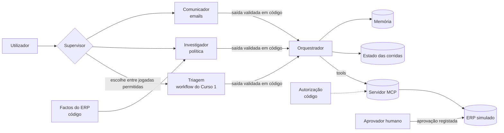

# PR Triage Agentic

Sistema multiagente que recebe pedidos de compra (Purchase Requisitions) em texto livre, investiga-os num ERP simulado, e aprova, rejeita, pergunta ou escala, com os efeitos verificados e as permissões aplicadas em código.

**Princípio: o modelo propõe, o Python decide.** Tudo o que se pode verificar de forma determinística (orçamento, contratos, cotações, escalões, permissões) é código. O modelo só entra onde há interpretação: ler o texto, ler a política, escolher as cláusulas aplicáveis e escrever.

Projeto final do curso *Agentic AI: Da Arquitetura à Implementação* (EDIT, Curso 2). É a evolução do projeto do Curso 1, uma triagem de requisições com RAG, que se mantém como **baseline** na etiqueta `v1-curso1`.

## Como correr

```
uv sync
cp .env.example .env                       # preencher OPENAI_API_KEY (a chave só existe aqui)
uv run python scripts/build_index.py       # índice da política (embeddings)
uv run python scripts/agentic.py init      # ERP de demonstração, dados sintéticos
uv run pytest -q                           # 250 testes, sem chave e sem rede
```

Uma corrida (usa o modelo real e o servidor MCP, lançado automaticamente por stdio):

```
uv run python scripts/agentic.py run "Preciso de 2 monitores, 600 euros, centro de custo CC-TI-100" --as ana.silva@exemplo.pt --id demo1
```

| Comando | O que faz |
|---|---|
| `run "<texto>" --as <email> --id <id>` | Inicia uma corrida |
| `reply <id> "<texto>"` | Responde a uma pergunta do sistema |
| `quote <id> <fornecedor> <valor>` | Regista uma cotação no ERP |
| `approve <id> [--reject]` | Regista a decisão do aprovador humano (acima de 5 000 €) |
| `resume <id>` | Retoma uma corrida pausada ou interrompida |
| `show <id>` | Mostra o estado, os passos e o pedido no ERP |
| `memory list \| correct \| forget <email>` | Gere a memória de um requerente |
| `--no-mcp` (antes do comando) | Chama as tools diretamente, sem MCP |

O servidor MCP também corre à parte (`uv run python -m pr_triage.toolserver --erp state/erp.db`), para qualquer cliente MCP se ligar às mesmas tools. A interface (`uv run python scripts/run.py`, Streamlit) é atualizada para o fluxo agêntico: *a completar quando estiver feita*.

## Arquitetura



| Papel | O que faz | Quem decide |
|---|---|---|
| **Supervisor** | Escolhe a próxima jogada entre as que o código permite. Se só há uma, nem chama o modelo | Código calcula as jogadas, o modelo escolhe |
| **Triagem** | O workflow do Curso 1: deteta manipulação, extrai e valida dados, determina o escalão, consulta a política | Misto, como no Curso 1 |
| **Investigador** | Recebe os factos já verificados e pesquisa a política: cláusulas aplicáveis, veredicto, perguntas | Modelo, com saída validada |
| **Comunicador** | Escreve o email de decisão ou o dossier para o aprovador | Modelo, com validação de números, nomes e cláusulas |

O Supervisor não executa nada: o orquestrador corre os especialistas e as tools, grava o estado depois de cada passo, e só tem as jogadas que a função `allowed_moves` devolve. Se o modelo pedir uma jogada não permitida, a corrida escala.

### Tools e MCP
14 tools com contrato (entrada em Pydantic, saída num envelope `{ok, data, error{code, retryable}}`): 10 de leitura (`get_person`, `get_cost_center`, `get_budget`, `get_supplier`, `find_framework_contracts`, `search_catalog`, `get_pr`, `get_quotes`, `get_approval_status`, `search_policy`) e 4 de escrita (`register_pr`, `approve_pr`, `reject_pr`, `send_email`). Um servidor MCP (fastmcp, stdio) expõe-nas, e **todas as chamadas das corridas passam por ele**. As escritas levam um `run_id` e são idempotentes. A autorização está dentro das tools, por isso é aplicada seja quem for o cliente.

## Políticas e permissões

| Valor | Quem decide |
|---|---|
| Menos de 1 000 € | O agente aprova, se não houver bloqueios |
| 1 000 a 5 000 € | O agente aprova se as cláusulas permitirem, e rejeita se bloquearem. Exige cotações de fornecedores distintos, salvo contrato-quadro em vigor (2 cotações, 1 se urgente) |
| Mais de 5 000 € | O agente não decide. Envia o dossier ao aprovador, e só avança com uma aprovação humana válida |

A aprovação humana tem de ser de outra pessoa que não o proponente, do mesmo pedido e da mesma decisão, dentro do prazo e sem o valor ter subido. É revalidada sempre que a corrida é retomada. A triagem a recusar manipulação, e um escalão incoerente com o valor, travam qualquer decisão.

## Decisões de desenho

- **Factos em código, política no modelo.** Na primeira versão o Investigador chamava as tools e escrevia as verificações; falhava de formas diferentes de corrida para corrida (cotações inventadas, contrato não consultado, ids de cláusulas errados). Passei a recolha dos factos para código (`agents/facts.py`) e o modelo ficou só com a política, com uma tool de pesquisa. Com isto, as corridas medidas ficaram entre 15 e 40 s.
- **Validação em código de cada saída de especialista**, com devolução ao especialista e um número máximo de tentativas: relatório da triagem, parecer do Investigador, email do Comunicador. Cláusulas que o modelo não recuperou, números que não existem nos factos e nomes inventados são rejeitados.
- **Estado persistido após cada passo** (SQLite) e **retoma com reconciliação**: antes de continuar, o orquestrador lê o ERP, que é a fonte de verdade, e corrige o estado (pedido já registado, decisão já aplicada, email já enviado). Contradições escalam. Os efeitos têm chave de idempotência, por isso nada se duplica.
- **Efeitos verificados:** depois de aprovar ou rejeitar, uma verificação independente lê o ERP (estado, cláusulas, uma só ação no log).
- **Memória que pergunta e não decide:** ver abaixo.

### Memória
Guarda uma só coisa, por requerente: o centro de custo que usou e viu aprovado, quando difere do que o ERP lhe atribui. Só o código escreve, no fim de uma corrida aprovada e verificada, e só em formato fixo (um texto livre seria uma porta para injeção persistente).
- **Origem:** corrida, pedido, fonte e data de cada entrada.
- **Validade:** 90 dias, e revalidada no ERP a cada uso (centro de custo inexistente ou inativo invalida a entrada).
- **Correção:** uma entrada nova substitui a anterior e o histórico fica (`memory correct`, `memory forget`). Quando o ERP contradiz a memória, ganha o ERP.
- **Isolamento:** a leitura está presa ao requerente da corrida; a memória de um nunca aparece a outro.
- **Uso:** só quando o ERP não tem resposta, e nunca é aplicada sozinha: o sistema sugere ("Da última vez usaste CC-X…") e o utilizador confirma.

## Falhas controladas

| Falha | Como é simulada | O que acontece |
|---|---|---|
| Dados em falta | Pedido incompleto | Completa pelo ERP, ou pergunta ao utilizador |
| Orçamento insuficiente, centro de custo inativo | Dados do ERP | Pergunta ao utilizador; o `approve` é recusado pela tool se for tentado |
| Cotações em falta | Pedido de 1 000–5 000 € sem cotações | Pausa a pedir cotações; retoma depois de registadas |
| Acima do limite do agente | Pedido de mais de 5 000 € | Dossier ao aprovador e pausa; sem aprovação válida nada é executado |
| Saída inválida de um especialista | Modelo de teste que responde mal | Devolvida ao especialista, com um máximo de tentativas; depois escala |
| Modelo ou ERP indisponível | `Faults` no ERP, erro 503 do modelo | Falha com `retryable`; o Supervisor repete até ao limite e escala |
| Resposta perdida depois de o efeito acontecer | `drop_response` no ERP | A repetição devolve o resultado original, sem duplicar |
| Servidor MCP em baixo | Ligação fechada | `mcp_unavailable` (retryable) |
| Processo interrompido a meio | Teste que interrompe o processo logo após o efeito | `resume` reconcilia com o ERP e continua, sem duplicar |
| Aprovação humana expirada na interrupção | Relógio avançado | Recusada em código; a corrida escala |
| Tentativa de manipulação no texto | Texto com instruções | Recusada pela triagem; nada é gravado |

## Baseline e versões

| Versão | Etiqueta | O que faz |
|---|---|---|
| Curso 1 | `v1-curso1` | Workflow de triagem com RAG, sem ERP, sem agentes e sem efeitos |
| Curso 2 | `v2-agentes` e seguintes | Agentes, tools por MCP, ERP, retoma, memória |

O baseline só consegue dizer "pronto", "faltam dados", "rejeitado" ou "ação manual", sobre o texto. Não consulta orçamentos, contratos, cotações nem fornecedores, e não executa nada. As corridas reais que guiaram o desenho, com os problemas que revelaram e as correções, estão em `docs/execucoes/`:

- `2026-11-24-factos-antes-das-correcoes.txt` e `2026-11-24-factos-depois-das-correcoes.txt`: dois defeitos reais (a verificação a escalar um pedido já aprovado, e uma pergunta a ser escalada em vez de feita) e a sua correção.
- `2026-11-24-memoria.txt` e `2026-11-24-memoria-pergunta.txt`: ciclo completo da memória, com sugestão, confirmação e aprovação.

> A completar: avaliação comparativa nos mesmos casos (baseline contra versões).

## Limitações

- O texto livre do modelo (resumo da investigação, corpo do email) pode contradizer os factos. As verificações e o veredicto são os que decidem, e os emails passam por validação de números, nomes e cláusulas, mas uma afirmação falsa com nomes legítimos pode passar.
- A variabilidade do modelo continua: os validadores com tentativas adicionais limitam-na, não a eliminam. Quando falha, o sistema falha para o lado seguro (pergunta ou escala), nunca para o de executar.
- A triagem do Curso 1 exige a quantidade nos serviços, e não encontra evidência de política para pedidos de consultoria (o Investigador compensa pesquisando a política por si). Mantive-a como estava, para o baseline ser comparável.
- A cláusula 8.1 (limiar jurídico de 4 000 € a partir de setembro de 2026) é aplicada pelo modelo na interpretação, não por regra em código.
- O ERP, os aprovadores e as aprovações são simulados.
- Não testei injeção de instruções nos dados devolvidos pelas tools (só no texto do pedido).

## Estrutura

```
app/                     interface (Streamlit)
scripts/                 run.py, build_index.py, agentic.py (CLI)
src/pr_triage/
  workflow.py, rag/, llm/, domain/    triagem do Curso 1
  erp/                   ERP simulado (SQLite), dados sintéticos e falhas
  authz.py               autorização em código
  tools/                 contratos, envelope e tools de leitura e escrita
  toolserver/            servidor e cliente MCP
  agents/                triagem, investigador (e factos), comunicador
  supervisor/            estado, jogadas permitidas, orquestrador, reconciliação
  memory/                memória por requerente
data/policies/           documentos de política (cláusulas com ids estáveis)
docs/execucoes/          corridas reais usadas como evidência
tests/                   250 testes
```